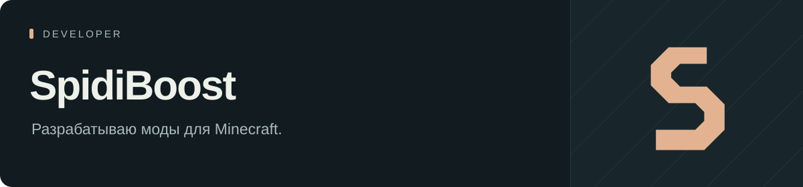

Пишу клиентские моды на Fabric. В основном — инструменты для игры и модерации на ReallyWorld.

Моды выпускаю в **[SpidiBoostMods](https://github.com/SpidiBoostMods)**. Там же лежат инструкции и последние версии.

### Над чем работаю

- **[6ubaaFP](https://github.com/SpidiBoostMods/6ubaaFP)** — проверки игроков, инвентарей и регионов.
- **[SpidiCard](https://github.com/SpidiBoostMods/SpidiCard)** — поиск ключ-карт.
- **[SpidiBan](https://github.com/SpidiBoostMods/SpidiBan)** — работа со списками игроков и историей наказаний.
- **[MuhaShist](https://github.com/SpidiBoostMods/MuhaShist)** — подсчёт качественных банов по истории. Открытый исходный код.
- **[LittlePet](https://github.com/SpidiBoostMods/LittlePet)** — питомцы в Minecraft.

### Связаться

По вопросам модов и подписок — **[VK](https://vk.ru/paveljaparov)**. Ошибку можно описать в Issues нужного проекта: версия мода, что делал и что пошло не так.
